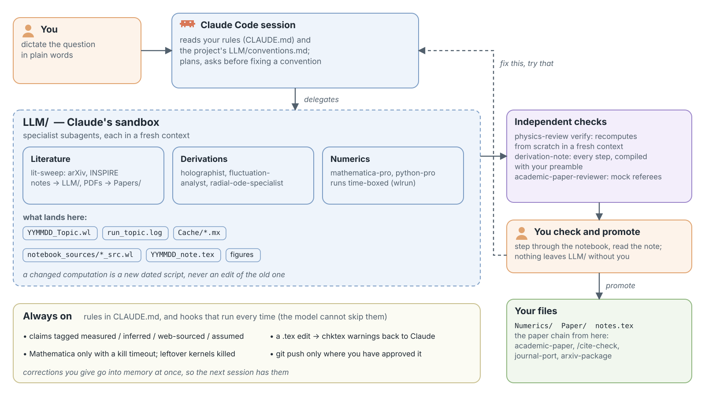
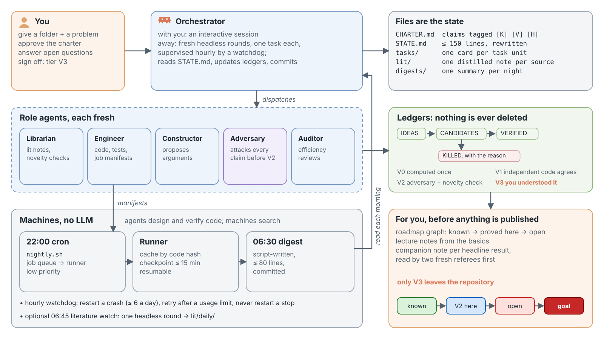

# claude-loadout

My Claude Code configuration as a theoretical physicist: global rules, skills, subagents, slash commands and hooks for research in high-energy theory (holography, AdS/QCD), for mathematics run as an autonomous program, and for hobby coding. It is the public export of the private dotfiles I use every day; the export drops what only makes sense for me (my blog tooling and my personal writing-style corpus).

You will want to change things. `claude/CLAUDE.md` in particular is written for me, and several skills assume my project layout and my habits. Read `claude/GUIDE.md` first; `claude/INDEX.md` lists every skill, agent, command and hook with one line each.

## Two research setups

**Physics, with me in the loop.** I dictate a question; a Claude Code session plans it and delegates to specialist subagents (literature, derivations, numerics). Everything Claude makes goes into the project's `LLM/` folder: dated scripts, logs, caches, generated notebooks, draft notes. Independent checks run in fresh contexts. Nothing reaches my own files or a paper until I have checked it and promoted it myself.



**Mathematics, autonomous.** A program that runs for weeks from a folder and a problem: a charter whose claims are tagged known / to verify / hypothesis, ledgers that move ideas to candidates to verified results (or to a killed list), verification tiers from "computed once" to "the owner understood it end to end", fresh adversary agents, compute jobs run overnight by cron without any LLM, an hourly watchdog, headless orchestrator rounds and a daily literature watch. Only the last tier is publishable. The headless rounds are tested with a fake CLI but have not yet run a real program unattended; the rest has run on one real program since October 2026. The skill is `research-autonomous`; it scaffolds the scripts from `claude/skills/research-autonomous/kit/`.



Both are generated by `claude/docs/diagrams/generate.py`.

## What is inside

| Area | Tools |
|---|---|
| Research projects | `research-init` (layout, conventions file, the `LLM/` flow), `research-autonomous`, `autonomous-loop` (one unattended night, with the shared rails in `rails.md`) |
| Physics | agents `holographist`, `fluctuation-analyst`, `radial-ode-specialist`, `convention-translator`, `mathematica-pro`; skills `physics-review` (independent recomputation, gap finding), `derivation-note`, `mathematica-notebook`; `tools/wlrun` (Mathematica with a kill timeout and a memory cap) |
| Literature and papers | `lit-sweep` (BibTeX only from INSPIRE or Crossref), `/cite-check`, `academic-paper`, `draft-sections`, `academic-paper-reviewer` (simulated referees), `academic-pipeline`, `journal-picker`, `journal-port`, `arxiv-package`, `share-to-github` |
| Code | `python-pro`, `debugger`, `systematic-debugging`, `test-driven-development`, `simplify-legacy`, `architecture-reviewer`, `security`, `ui-designer`, `general-loop` (multi-wave builds), `/lint`, `/ship`, `/external-plan` |
| Data and finance | `data-analyst`, `quant-analyst`, `qual-analyst`, `academic-economist` |
| Hooks | push policy and Mathematica guard (`bash-guard.py`), protected checks during loops, chktex after each `.tex` edit, leftover kernels and LaTeX runs reported before a session ends, local auto-commit of edits to this repo |
| Maintenance | `propose-persistence`, `/memory-audit`, `/sync-dotfiles`, `tools/check.py` (regenerates `INDEX.md`, finds dangling paths) |

## Install

These steps assume no prior experience. They are written for Linux and macOS; I have tested them on Ubuntu only. Windows is untested: the hooks are shell and Python scripts, so running everything inside WSL (Windows Subsystem for Linux) is the closest match.

**1. Open a terminal.** A terminal is a window where you type commands. Ubuntu: press Ctrl+Alt+T. macOS: press Cmd+Space, type *Terminal*, press Enter. Type or paste each command below and press Enter.

**2. Install the tools this setup needs:** Git (downloads and versions files), jq (reads JSON in the hooks) and Python 3.

```bash
# Ubuntu / Debian
sudo apt install git jq python3
# macOS, after installing Homebrew from https://brew.sh
brew install git jq python
```

**3. Install Claude Code** (the official installer; it also tells you how to log in):

```bash
curl -fsSL https://claude.ai/install.sh | bash
```

Then run `claude` once, log in with your Claude account, and type `/exit` to leave. Documentation: [code.claude.com/docs](https://code.claude.com/docs).

**4. Download this setup** into `~/Git/dotfiles` (the hooks find their scripts by that path):

```bash
git clone https://github.com/ahippelainen/claude-loadout.git ~/Git/dotfiles
```

If you already have a folder `~/Git/dotfiles`, clone somewhere else and replace `$HOME/Git/dotfiles` in `claude/settings.json` with your path.

**5. Install it:**

```bash
cd ~/Git/dotfiles
./install.sh
```

It links the configuration into `~/.claude/`, the folder Claude Code reads its settings from. Your own files there are kept as `<name>.backup.<date-time>`, and skills you installed yourself stay untouched. It ends with `Done.`; re-run it whenever you add or rename a skill or agent.

**6. Check it works.** Start `claude` in any project folder and type `/` : the commands of this setup (for example `/lint`, `/cite-check`) appear in the list. Ask "Which skills do you have?" to see the skills.

**7. Make it yours.** Nothing here is meant to be used unread.

- Rewrite `claude/CLAUDE.md`: it describes me and my rules, and Claude reads it in every session.
- Know what the hooks do: `bash-guard.py` stops every `git push` to a repository that is not listed as `free` in `claude/push-policy` until you approve that push in the chat; another hook commits each edit you make inside `~/Git/dotfiles` locally (it never pushes).
- To have `draft-sections` write like you, run the `style-analyst` agent on a few of your own papers; it fills `claude/contexts/authorial-style.md`, which ships as an empty seed.

**Update** with `cd ~/Git/dotfiles && git pull`. **Uninstall** by removing the links and restoring any backups:

```bash
find ~/.claude -maxdepth 2 -type l -lname "$HOME/Git/dotfiles/*" -delete
ls ~/.claude/*.backup.*    # rename the backups you want back, e.g. settings.json.backup.<date-time> -> settings.json
```

## Credits

This started in 2026 as a curated mix of community projects and has since been pruned and largely rewritten. The research tools (the two research setups, the physics agents, `lit-sweep`, `derivation-note`, `journal-port`, the hooks, the loop rails) were written for this setup, with Claude, from what went wrong in real runs. The `academic-paper` family began from [academic-research-skills](https://github.com/Imbad0202/academic-research-skills) and has been rewritten. `systematic-debugging`, `simplify-legacy`, `physics-review`, `data-analyst`, `quant-analyst` and `/lint` still contain substantial text from the community collections they came from, among them [superpowers](https://github.com/obra/superpowers) and [everything-claude-code](https://github.com/affaan-m/ECC) (now renamed ECC). If you recognise your work and want a specific credit, open an issue.

## License

MIT, see [LICENSE](LICENSE). Upstream projects keep their own licenses.
